# Demo guide

**The idea:** you job-hunt worldwide from Canada.
**Before:** from your own internet, the careers site refuses most of the scan. **After:** with DataImpulse,
you get 100%. Then your **AI agent** uses the same DataImpulse tools to read and score the best jobs.

---

## Part 1 · Setup (once)

**1. Open DataImpulse → Plans.**
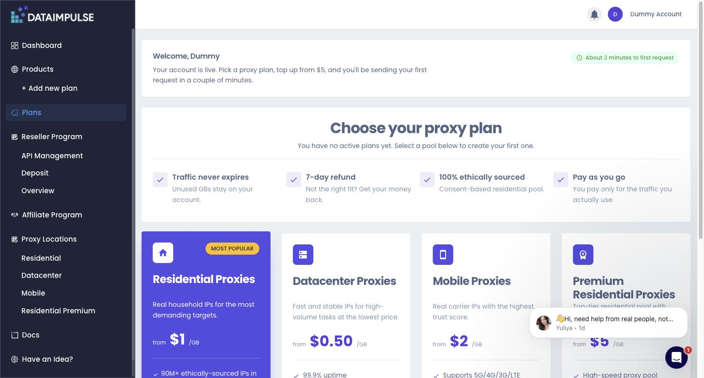

**2. Residential Proxies → Create new plan.**
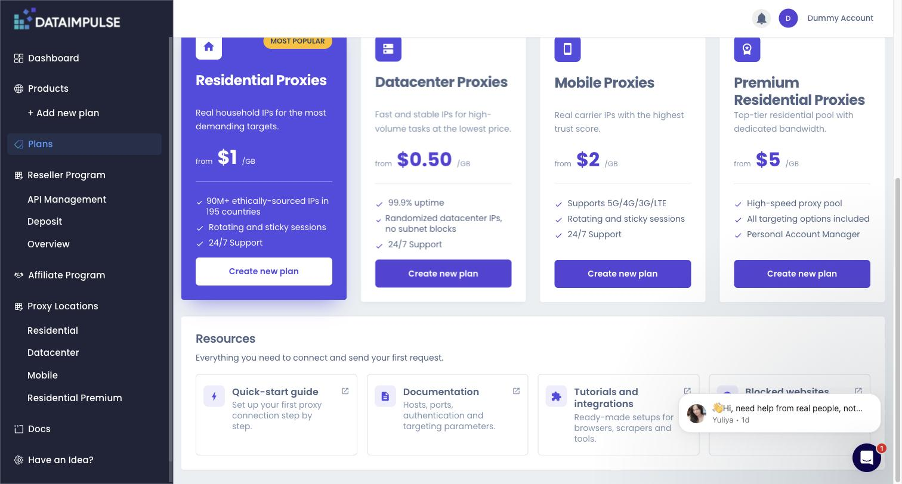

**3. Pick the GB amount → Proceed.**
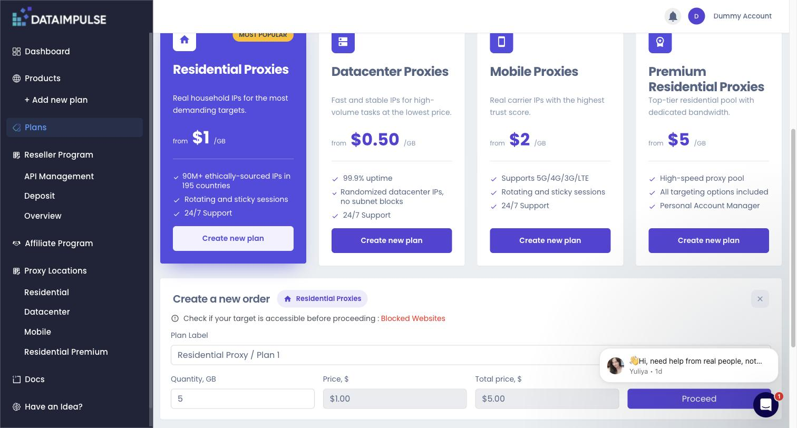

**4. Open your plan. Copy Login and Password.**
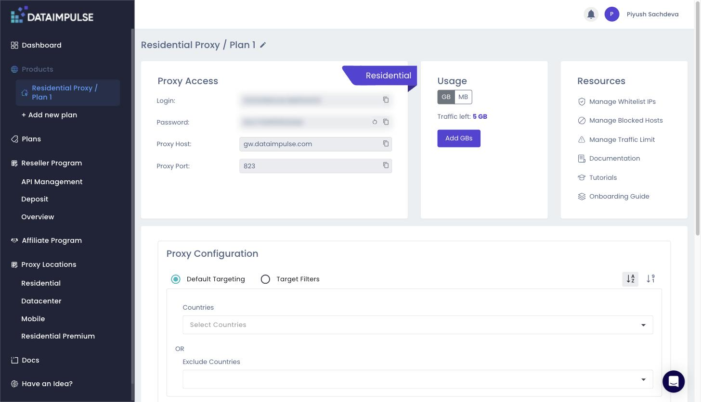

**5. Paste them into the project and test:**
```bash
cd ~/repos/sponsorship-work/job-agent
cp .env.example .env        # paste login + password here
uv run python scripts/test_proxy.py
```
Everything must say **PASS**.
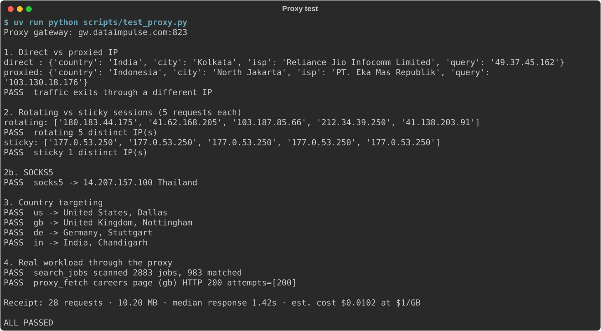

**6. Edit `profile.md`** with your roles, skills and locations. The AI agent scores jobs against it.

---

## Part 2 · The demo (what you record)

**Start it:**
```bash
DEMO_FRESH=1 ./demo/demo.sh
```
Press **Enter** to go to each next step.

### BEFORE (no proxy)

**Step 1 · Your IP.** Shows your city in Canada.
> Say: "Every request comes from this one home connection."


**Step 2 · The scan.** A settings box first (connection, 1,000 pages, timeouts, retries). Then **every request scrolls by**: target URL, HTTP status, size, time and result. The panel turns **red**: about **700 of 1,000 pages refused**, each with the reason *'Server Busy' bot page instead of job data*. Only about **31%** of the data comes back.
> Say: "A hundred or so pages in, the site starts refusing me. I'm missing about 7,000 job listings."

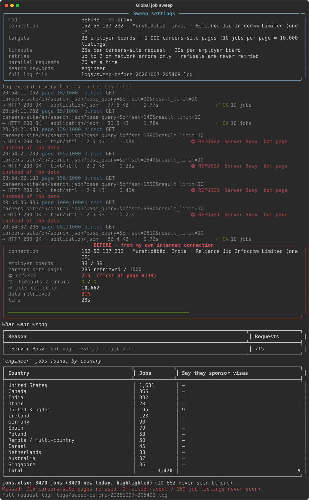

The same lines are saved to `logs/sweep-before-….log`. Here is the moment the refusals start, plus the summary at the end of the file:
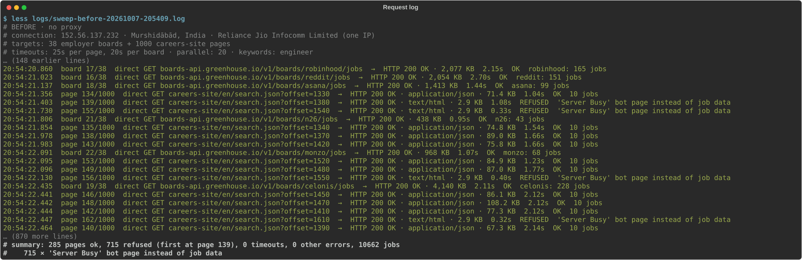

### SWITCH (DataImpulse)

**Step 3 · Turn on DataImpulse.** The terminal shows the gateway, with the login and password hidden.
> Say: "So I switched on DataImpulse. Just a login, a password and a port."


Cut to the dashboard and show:
- Rotating / Sticky, HTTP / SOCKS5, sticky time up to 120 min
  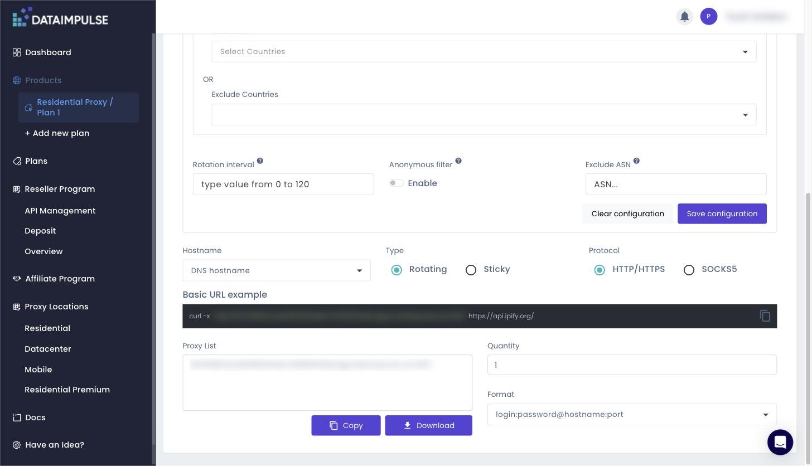
- Live IP count per country
  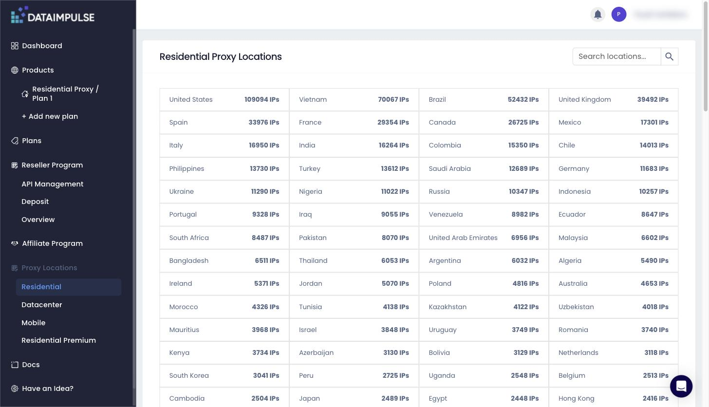

### AFTER (with DataImpulse)

**Step 4 · The same scan again.** Every line says `proxy`. The panel stays **green**: **1,000 / 1,000 pages, 0 refused, 100%**, with dozens of household IPs. Dropped connections show as ↻ RETRY and then succeed.
> Say: "Same scan. Nothing refused, and over 7,000 jobs I'd never seen."

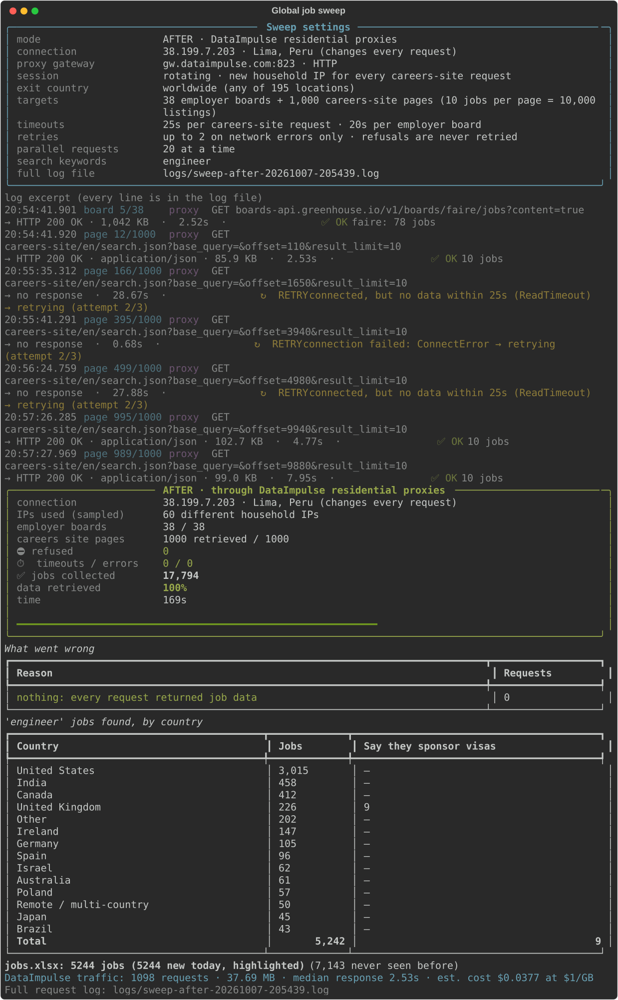

Its log shows a dropped connection being retried on a new IP, and the summary: 1,000 OK, 0 refused:
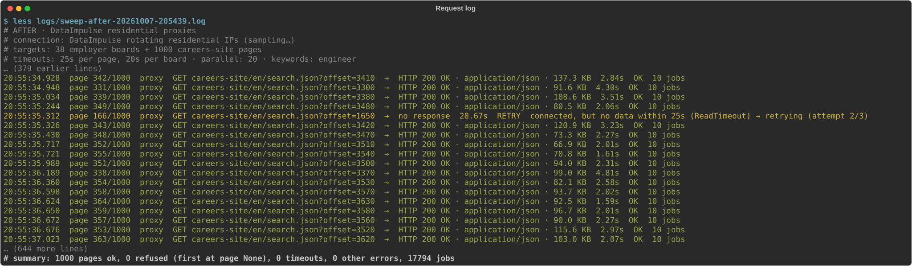

**Step 5 · Start the MCP server and hook it into Claude Code (you type this live).** The demo pauses,
shows a short command card, and gives you a `(claude setup) $` prompt. You'll use **two terminals**.

**5a. Terminal 2: start the server** and leave it running:
```bash
cd ~/repos/sponsorship-work/job-agent && uv run jobsearch-mcp --http
```
It prints its URL (`http://127.0.0.1:8765/mcp`), the DataImpulse gateway, and the command to connect Claude.
> Say: "This is my DataImpulse MCP server: AI-agent tools that send every request through residential IPs."

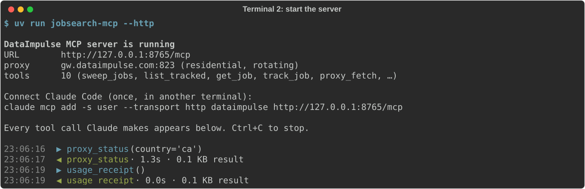

**5b. Terminal 1: connect Claude Code to it:**
```bash
claude mcp add -s user --transport http dataimpulse http://127.0.0.1:8765/mcp
```


**5c. Check it's connected:**
```bash
claude mcp list
```


**5d. Open Claude** with `claude`. Type `/mcp`, pick **dataimpulse**, and show its tools (Esc to close):
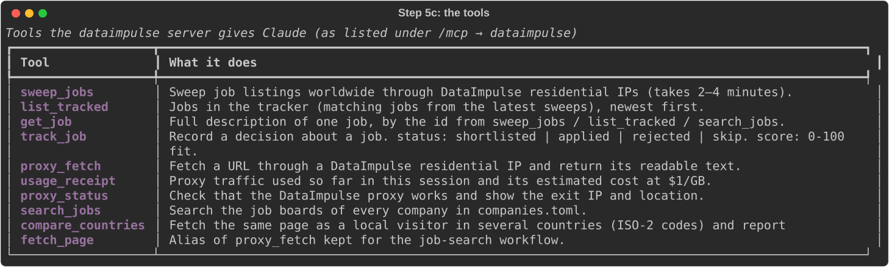

**5e. Ask it** (the text is on the card, ready to copy):
> *Use the dataimpulse tools. Look at the jobs from my latest sweep and find the 5 best matches for my
> profile.md, at most one per company. Read each posting with get_job, save a 0–100 score and a one-line
> reason with track_job, then show me a ranked table and the usage receipt.*

If Claude asks permission to use a tool, choose **Yes, and don't ask again**. Claude shows a ranked table:
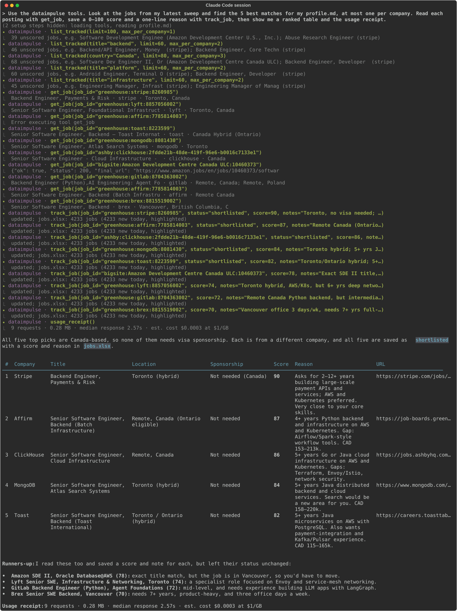

**Meanwhile, terminal 2 shows every tool call live** (▶ call, ◀ result, time and size). Put it side by side with Claude on screen:
> Say: "On the right you can see every call my AI agent makes, all going through DataImpulse."

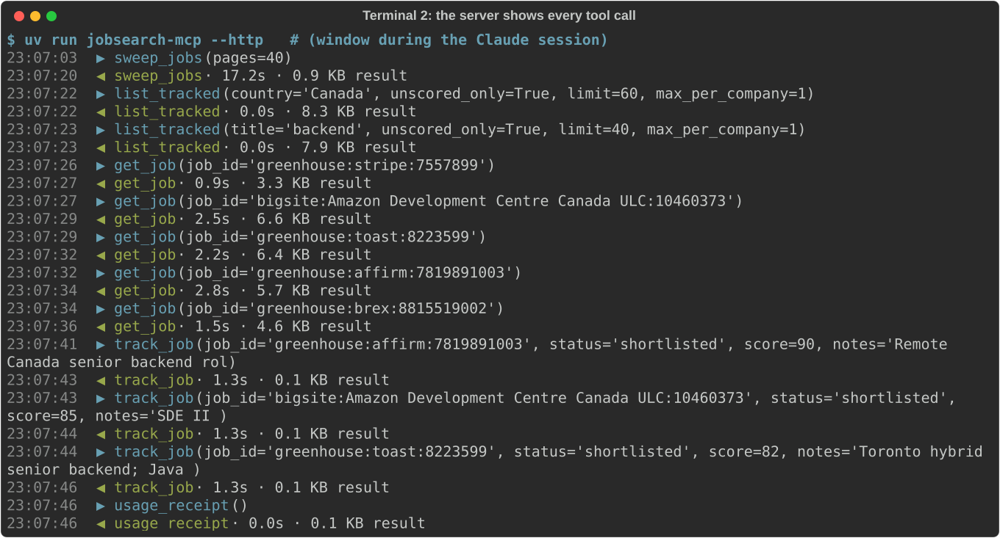

**5f.** Type `/exit` in Claude, then `exit` to return to the demo. Leave the server running or stop it with **Ctrl+C**.

*No AI branding wanted? Run the demo with `DEMO_HEADLESS_AI=1`. Step 5 then prints the same kind of result as plain output, with no typing:*
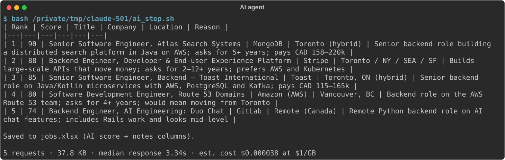

**Step 6 · Any country.** Real home IPs in 8 countries; rotating vs sticky.
> Say: "And I can search as a local anywhere in the world."

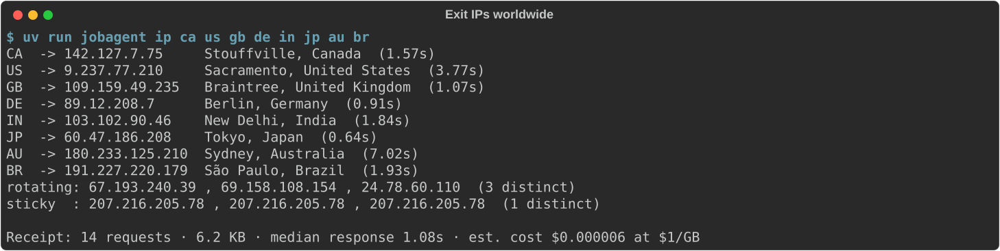

**Step 7 · The spreadsheet.** Every job by country. The AI-scored ones have a score and a note.
> Say: "Every morning, new jobs land here, already scored."

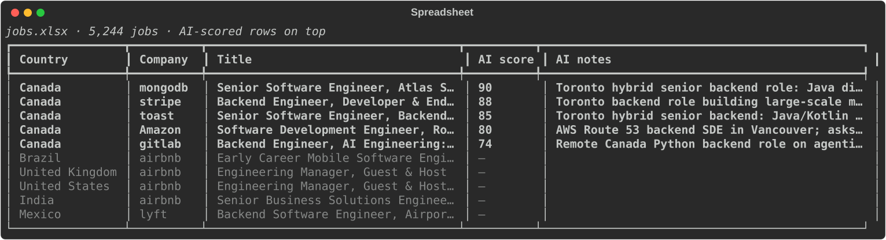

**Step 8 · The cost.** About 40 MB, roughly 4 cents.
> Say: "All of that cost about 4 cents. $1 per GB, pay-as-you-go, and it never expires."


Then show the same cost in the dashboard **Usage Chart**:
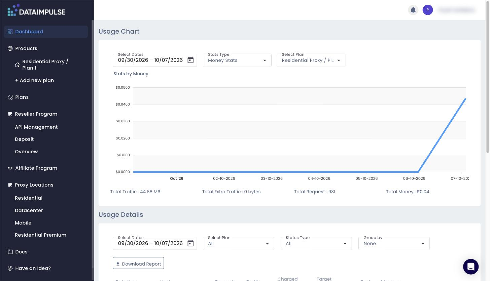

### Finish
Face cam with the **DataImpulse logo**. Give your **own honest endorsement**, then the price: **$1/GB residential, $2/GB mobile, 24/7 live support**.

---

## Using the MCP server any time (after the demo)

Two ways. Pick one:

| | Start it yourself (shown in the demo) | Let Claude start it |
|---|---|---|
| Start | `uv run jobsearch-mcp --http` (keep it running) | nothing to do: Claude starts it when a session opens |
| Connect, once | `claude mcp add -s user --transport http dataimpulse http://127.0.0.1:8765/mcp` | `claude mcp add -s user dataimpulse -- uv run --directory "$PWD" jobsearch-mcp` |
| Good for | watching every tool call live | everyday use, with no extra window |

Only one `dataimpulse` can be registered at a time. Switch with `claude mcp remove dataimpulse -s user`.

---

## Rules (from DataImpulse)

- **Before you record:** do one practice run, then **wait 5 minutes**. In the practice run, open `claude` once in this folder and accept the "trust this folder" prompt. Then reset Step 5 so 5b works on camera: `claude mcp remove dataimpulse -s user`.
- **Blur:** the login, the password and the account name.
- **No other brands:** don't name other proxy companies or the big careers site (`demo.sh` hides its name). The live Claude session in Step 5 shows Claude's interface, so **ask DataImpulse first** whether that's OK. Otherwise use `DEMO_HEADLESS_AI=1`.
- **Approval:** send DataImpulse the script and then the final video **before publishing**.
- **When you publish:**
  - put their link in the **first 2 lines** of the description
  - pin their link in a comment **within 24 h**
  - keep the video **public for 12 months**

**Logs:** every line on screen is also saved to `logs/sweep-before-….log` and `logs/sweep-after-….log`, with a summary at the end.

**If something goes wrong:** if Step 2 shows few refusals, add `--conc 30` to both `jobagent.sweep` lines in `demo/demo.sh`. If it's refused from page 1, wait 5 minutes. A few sites (e.g. stripe.com) are blocked by DataImpulse itself (`SITE_PERMANENTLY_BLOCKED`). The agent then reads those postings with `get_job` instead.
